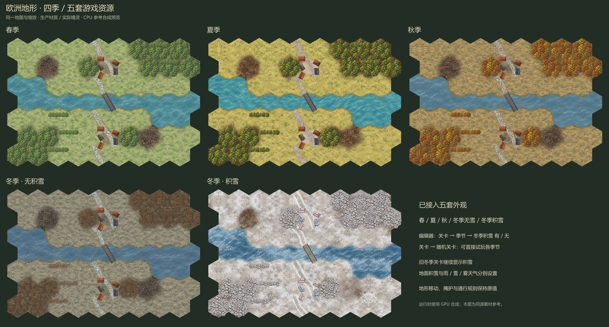
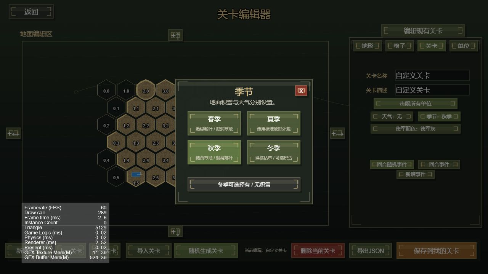

# 欧洲四季地形 · 已接入

2026-10-24：欧洲战场现支持春季、夏季、秋季、冬季无积雪、冬季积雪五套外观。

2026-10-25 秋季与冬季田野细节修正：使用内置 imagegen 重做 `sources/autumn/grass-fine.png` 与 `sources/winter_bare/grass-fine.png`，分别补充金黄短草、碎草和灰褐伏地枯草、少量裸土；与新版春季统一采用 0.68 的草纹细节强度。保持原季节中间色及低矮草地比例，同步生成道路周边和缩略图。哈希审计确认仅两季的 `grass` 材质及 84 个派生资源变化；春、夏、积雪冬季与太平洋未改变。9 项季节回归与 GPU 拼接检查通过。[同镜头比例对照](../source_art/terrain/seasons-design-20261024/autumn-winter-grass-detail-20261025/comparison.png) · [内置 imagegen 提示词](../source_art/terrain/seasons-design-20261024/autumn-winter-grass-detail-20261025/prompts.json)。

2026-10-25 春季田野细节修正：重做 `sources/spring/grass-fine.png`，增加正常游戏缩放下可见的短草叶、碎草、少量裸土与自然疏密变化；春季草纹细节保留强度从 0.40 调为 0.68，保持原季节中间色与低矮草地比例。同步重建春季地表、缩略图和道路周边；其他季节哈希保持不变。9 项季节回归通过，7 组 GPU 拼接误差为 0。[同镜头比例对照](../source_art/terrain/seasons-design-20261024/spring-grass-detail-20261025/comparison.png) · [内置 imagegen 提示词](../source_art/terrain/seasons-design-20261024/spring-grass-detail-20261025/prompt.txt)。



2026-10-24 草纹尺度修正：春、秋、无雪冬季的草地改用独立的完整细草源图 `sources/{season}/grass-fine.png`，取代从九宫格裁切的粗草簇。保持季节中间色，重新生成连续材质、地形缩略图和道路周边底色。逐材质哈希确认三季仅 `grass` 改变；9 项季节回归通过，7 组 GPU 接缝误差仍为 0。修改前后同镜头与单位比例参照见 [草纹尺度对照](../source_art/terrain/seasons-design-20261024/grass-scale-fix-20261024/comparison.png)，内置 imagegen 的精确提示词见 [prompts.json](../source_art/terrain/seasons-design-20261024/grass-scale-fix-20261024/prompts.json)。

## 使用

- **关卡编辑器 → 关卡 → 季节**：选择春、夏、秋、冬；冬季下点击“冬季积雪：有 / 无”切换地面覆盖。地图缩略图立即更新。
- **关卡 → 随机关卡**：新增欧洲春季、欧洲秋季、欧洲冬季无雪三个入口，原欧洲普通与冬季入口继续提供夏季和积雪冬季。
- 雨、雾、小雪、大雪等天气单独设置。降雪粒子不会自动改变地面积雪；晴天也可使用积雪地形。
- 四季共用原有移动、掩护、视线和桥梁通行规则。



## 关卡数据与兼容

```json
{ "season": "spring" }
{ "season": "summer" }
{ "season": "autumn" }
{ "season": "winter", "snowCover": "none" }
{ "season": "winter", "snowCover": "snow" }
```

未指定 `season` 的旧关卡保持夏季；旧 `season: winter` 且未指定 `snowCover` 时保持积雪。存档记录两个字段；旧存档继续按关卡本身的季节解释。关卡导入、编辑保存、JSON 导出和随机关卡保留这些字段。PVP 继续读取双方共用的关卡数据；本次没有更改联机协议。

## 美术与运行时

使用内置 imagegen 制作春、秋、无雪冬季的三张九宫格地面源图和三张透明四树冠源图；春季叶色及无雪冬季裸枝另做了一轮定向修订。夏季与积雪冬季复用项目现有资源。

新增 **165 项运行时资源**，每种新增外观 55 项，均包含 Cocos 元数据：1 个独立材质包、4 张树冠、8 张地形底图、1 张森林缩略图、1 张院落、39 张道路变体、1 张钢板桥。每个材质包含 9 张独立基础纹理，并派生欧洲沙地和浅水材质；主材质 384×384，树冠 256×256，地形图 222×256。

- 素材位置：`assets/resources/textures/terrain/seasons/{spring,autumn,winter_bare}/`。
- 道路与桥梁：`assets/resources/textures/terrain/european_roads/`，文件名分别含 `spring`、`autumn`、`winter_bare`。
- 源图、生成提示词、生产清单、树冠小尺寸检查与五套地图对照：`source_art/terrain/seasons-design-20261024/`。
- 季节选择与默认值：`assets/scripts/core/TerrainSeason.ts`。

战斗场景在关卡数据加载完成后请求当前外观，统一切换连续地面、树冠、院落、道路和桥梁。树篱和矢量兜底绘制使用同套季节配色；积雪屋顶仅在积雪冬季启用。关卡切换与读档采用加载批次校验，上一季节迟到的回调不会覆盖当前地图。加载完成前显示地形进度界面。

GPU 图集继续使用当前 1930×1930 布局，按当前外观生成。样式变化释放旧分块缓存；同样式的相机平移缩放继续复用缓存。CPU 参考合成器、地形精灵回退、地图详情和编辑器使用同源资源。

## 重建

```powershell
node tools/buildEuropeanSeasons.cjs
node tools/previewEuropeanSeasons.cjs
```

构建器保留现有 Cocos UUID，校验原夏季 / 积雪冬季 / 太平洋材质未被覆盖，并输出 `production-manifest.json`。源图及精确提示词保存在 `material-prompts.json`、`tree-prompts.json` 和 `tree-revision-prompts.json`。

## 验证

- `pnpm run typecheck` 通过。
- 本次相关回归测试 **38 / 38 通过**，含新增 9 项季节测试、旧冬季美术、天气、随机任务、编辑器、存档及战役检查点、诺曼底、CPU/GPU 地形、纹理边缘等检查。记录见 `tmp/season-final-regression.log`。
- `node tools/validateTerrainGpu.cjs` 通过 WebGL 1 编译和 WebGL 2 绘制；夏、积雪冬、春、秋、无雪冬、太平洋、诺曼底共 **7 组接缝误差均为 0**，水域遮罩和静止桥面检查通过。记录见 `tmp/terrain-gpu/pixel-result.json`。
- Cocos 3.8.8 实际预览已验证冬季无雪战场完整加载，裸枝、枯草和普通屋顶正常；编辑器春 / 秋 / 冬切换及积雪开关正常，无新增控制台错误。预览中原有的背景音乐缺失警告仍存在。
- `git diff --check` 通过。

扩大检查时仍发现四项旧素材基准不一致：`EuropeanTerrainVersions.test.js` 的 `pacific_rocks.png` 归档哈希、`WinterTerrain.test.js` 的旧雪树轮廓断言，以及 `EuropeanRoadAssets.test.js` 的旧道路口色值和出血断言。相关太平洋岩石、旧雪树及旧道路图片本次未修改；已核对问题图片与 HEAD 字节一致。这些断言仍失败，未将它们计入上面的 38 项通过结果。
