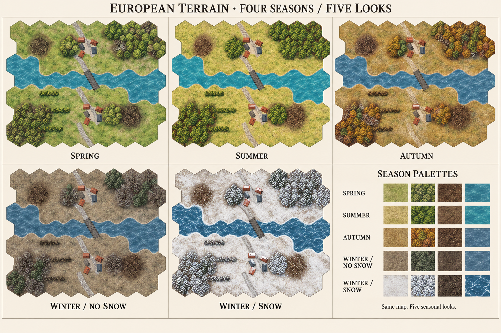

# 欧洲地形四季设计 · 四季、五套外观

日期：2026-10-24。本文为原始美术设计方案。五套外观现已完成素材制作并接入，使用方式、生产效果与验证记录见 [欧洲四季地形接入说明](EuropeanSeasons.md)。



## 设计方向

沿用项目现有垂直俯视、细纹理、低饱和色与柔和地形混合。普通版以当前欧洲夏季 V6 为基准，桥梁保持当前深灰钢板桥造型。四季分别是春、夏、秋、冬，冬季额外提供无积雪和积雪两种外观。

区分季节的重点依次为植被形态、草地状态、土壤湿润感和水色。单纯全图调色不足以表现四季，尤其冬季无雪必须制作落叶后的树冠轮廓。

图中上排从左到右为春、夏、秋；下排从左到右为冬季无积雪、冬季积雪、材质色调参考。概念图用于确定方向，不能直接切图当作可拼接地形素材；树枝细度、水面高光和细节密度还需在游戏实际尺寸下校准。

## 五套外观

| 外观 | 整体感受 | 开阔地与泥地 | 树林与树篱 | 水域、道路与村庄 |
| --- | --- | --- | --- | --- |
| 春季 | 清新、湿润、开始生长 | 灰嫩绿与浅橄榄绿交错；露出少量湿褐土；泥地深褐、湿润但保持粗糙纹理 | 阔叶树嫩叶较疏，树枝局部可见；常绿树偏深绿；树篱连续返青 | 河水偏青蓝；岸边湿土较深；浅灰碎石路有深色湿路肩；屋顶保留陶红与板岩灰 |
| 夏季 | 温暖、干燥、植被成熟 | 延续现有黄绿草地，掺少量枯黄和绿斑；泥地较干、棕褐颗粒明显 | 树冠最饱满，以橄榄绿和深绿为主；树篱浓密 | 延续现有蓝绿色河水；路面浅灰带土黄尘感；院落较干、颜色偏浅 |
| 秋季 | 收获后的衰败、潮湿 | 赭黄、草褐与残绿混合；落叶集中在林缘、树下和路肩；泥地比夏季更深 | 金黄、黄褐、少量铜红、残绿混合，夹少量裸枝；常绿树持续深绿；树篱变稀 | 河水降为灰蓝；碎石路保留灰色，不被落叶完全遮盖；屋顶基本沿用原材质 |
| 冬季无积雪 | 冷、萧瑟、潮湿沉暗 | 灰褐底色配低饱和灰橄榄草；倒伏枯草、暗褐裸土；泥地最深，局部湿痕 | 大部分阔叶树落叶，保留分叉树冠、枝条密度与暗色林床；少量深灰绿常绿树；树篱呈连续枝丛 | 冷灰蓝流动河水，深色湿岸；道路为冷灰碎石和暗湿路肩；屋顶、桥面完全无雪 |
| 冬季积雪 | 寒冷、明亮但保留地形层次 | 灰白积雪不规则覆盖；露出灰褐枯草；泥地中心深褐、边缘湿雪，不能整格涂白 | 落叶枝冠承雪，常绿树露出深绿暗部；林床比开阔雪地暗；树篱有断续雪帽 | 深冷蓝流水与少量岸缘薄冰；路面灰色压实车辙、两侧积雪；屋顶和桥侧积雪，保留陶红屋面、桥面深色通道 |

春季采用有嫩叶的生长期；秋季采用落叶期；无雪冬季采用尚未明显结冰的湿冷状态。这样每套风格都有稳定、明确的视觉特征，后续仍可扩展干冻或初霜变化。

## 配色起点

以下为基础材质的建议中间色，不是对整张地图覆盖滤镜。纹理仍需保留现有自然明暗。

| 外观 | 草地 / 雪地 | 阔叶植被 / 枝干 | 泥地 | 水面 |
| --- | --- | --- | --- | --- |
| 春季 | `#9AA76E` | `#778D47` | `#605044` | `#518B95` |
| 夏季 | `#B1AD70` | `#707B36` | `#786044` | `#4A919F` |
| 秋季 | `#A18C5E` | `#A17C38` | `#5C493B` | `#5B7F90` |
| 冬季无积雪 | `#8C8774` | `#645F51` | `#514A41` | `#567489` |
| 冬季积雪 | `#D7D9D4` | `#777B73` | `#62584D` | `#4B6F85` |

秋季阔叶树建议约一半黄褐，其余分配铜褐、残绿和裸枝，避免一整片纯橙色。常绿树在所有季节保持自己的绿色谱系，主要调整冷暖与亮度。

无雪冬季的枝干使用灰褐和深褐色，主枝比概念图略粗、略暗，避免细白枝条被误读为霜雪。全图不添加白霜、白色草尖或岸边冰雪装饰。

## 每类地形的制作要求

- **开阔地**：春季新草斑块、夏季干草纤维、秋季枯草与局部落叶、冬季倒伏草和裸土、积雪版断续雪被。避免均匀散点噪声和高对比重复花纹。
- **泥地**：五季保持同一不规则轮廓和粗糙土块。春秋偏湿，夏季偏干，无雪冬季暗冷，积雪版中心露泥。湿痕只作低对比暗斑，不能画成容易与水域混淆的大片蓝色反光。
- **树林**：各季保持同一林区边界、树木数量、树冠中心和占地关系。冬季制作枝冠结构与深色林床，落叶后也要一眼认出树林，不因透明区域增多而看起来成了开阔地。
- **树篱**：春夏有叶，秋季黄褐残叶，无雪冬季为较粗的枝丛；积雪附着在枝丛顶部。落叶后连续格边轮廓仍清晰，所有六方向采用同一规则。
- **道路**：保留浅灰碎石的视觉身份、宽度和六方向连接。季节差异主要放在湿路肩、尘土、落叶和积雪；道路中央始终可读。
- **桥梁**：延续当前钢板桥的几何、方向、接头和深灰结构。春秋冬通过湿色变化表现气候；雪仅覆盖积雪版本的边缘和部分桥面，通道保留深色车辙。
- **水域与岸线**：春夏偏青蓝，秋冬偏灰蓝；保持深浅水区分与连续岸线。冬季默认仍是流水，薄冰仅为积雪版岸缘装饰，不表示可通行冰面。概念图中冬季水面白色浪花偏强，正式材质应降低亮度和密度。
- **村庄、院落与屋顶**：无雪四套共用建筑几何，季节主要改变院落湿度、杂草和落叶；屋顶可轻微压冷，不需每季全部重画。积雪版使用独立积雪屋顶，保留原屋面颜色识别。
- **欧洲沙滩与浅水**：保留浅沙与浅水的身份；无雪冬季为冷灰褐湿沙，积雪版仅在陆侧加入断续雪斑。海堤、拒马、铁丝网与弹坑保持原有轮廓和可读性。

## 游戏可读性

1. 季节只改变外观，树林、树篱、泥地、水域的规则仍由原地形类型决定。落叶不自动减少掩护，积雪不自动改变移动成本，水域不因冷色或薄冰而变为可通行。
2. 保持严格垂直俯视与统一光照方向；屋顶只显示顶面，树木不引入侧视树干。季节不要改变桥宽、河岸位置、建筑轮廓或道路连接。
3. 地面纹理的对比低于单位、轮廓线和状态标记。绿色单位在春夏树林、黄褐伪装在秋草、白色伪装在雪地，都需在现有描边与阴影下可辨认。
4. 雪地使用灰白、浅灰和灰褐三级层次，避免纯白大面积铺底；林地暗于开阔雪地，泥地中心明显暗于周围。
5. 先检查常用战斗缩放与约 40px 树冠的阅读效果，再检查放大细节。枝条和落叶不能依靠细至一像素的线条传达地形身份。

## 素材计划

基于现有材质和预览工具的规格，建议按以下范围制作，正式尺寸仍以各资源现有规格为准：

| 素材组 | 交付内容 | 规格与复用 |
| --- | --- | --- |
| 连续地面材质 | 草、泥、土、林床、碎石路、院落、水、深水、木材等；积雪版额外含雪材质 | 主要材质沿用 384×384；按季节需要替换，可复用材质不重复绘制；沙滩另补季节参数或材质 |
| 树木 | 每种外观至少 4 个轮廓变体，保留落叶树与常绿树的固定身份 | 沿用 256×256 透明精灵；夏季复用现有 4 张，新增季节优先制作轮廓差异 |
| 树篱 | 有叶、残叶、裸枝、附雪四种表现 | 保持现有边界生成方式和方向；优先统一分枝轮廓及配色参数 |
| 屋顶 | 现有普通屋顶与积雪屋顶 | 复用现有各 4 张，常规输出 256×176；春秋无雪冬季主要调整院落 |
| 地形缩略图 | 每季开阔地、道路、泥地、树林、水域；涉及深水、沙滩、浅水时同步覆盖 | 原有主类缩略图约 222×256；由同套材质生成，避免编辑器与实战风格不一致 |
| 道路与桥梁预览 | 六方向道路连接、变体和三轴桥梁 | 沿用现有连接规则，由季节材质生成，不手工画五套连接逻辑 |

第一轮优先做春季、秋季、无雪冬季的草地、林床、泥地和树冠，夏季复用 V6、积雪版复用现有冬季资源并校准一致性。第二轮处理水岸、道路、村庄、树篱及诺曼底附加物。

## 接入设计（后续实施）

当前 `SeasonType` 只有 `summer | winter`，材质分为 `europeanSummer` 与 `europeanWinter`；战斗场景的树木、屋顶、道路等也有冬季分支。因此应统一选择外观，避免只切换地面却保留夏季树冠或积雪屋顶。

建议数据模型将季节和地面积雪分开：

```ts
type SeasonType = 'spring' | 'summer' | 'autumn' | 'winter';
type SnowCover = 'none' | 'snow';
// 关卡示例：{ season: 'winter', snowCover: 'none' }
// 积雪冬季：{ season: 'winter', snowCover: 'snow' }
```

- 编辑器选择春、夏、秋、冬；选择冬季后出现“积雪：无 / 有”。第一版仅冬季允许积雪，内部映射到五套外观。
- `weather` 继续描述当前晴、雨、雾、小雪、大雪；`snowCover` 描述已经形成的地面积雪，两者独立。晴天可以有积雪，小雪开始时也可以仍无积雪；第一版不新增动态积雪模拟。
- 兼容旧关卡：未设置季节继续使用夏季；旧 `winter` 且缺少 `snowCover` 时按积雪版解释；无雪冬季必须显式写 `snowCover: 'none'`。保存读取、PVP、随机关卡与编辑器采用一致的归一化规则。
- 统一外观选择涵盖连续地面 CPU/GPU、缓存键、水面动画、树冠、树篱、村庄院落、屋顶、道路桥梁、缩略图与兜底绘制。当前已有部分以 `winter` 决定撒雪和岸冰的处理，不能通过移除雪纹理单独完成无雪冬季。
- 只给当前地图的外观建立材质图集和缓存，继续遵守当前纹理尺寸预算；无需把五套材质同时塞进一张大图集。
- 首次接入范围是欧洲；太平洋和城市专用材质保持各自设计，避免被欧洲落叶与冷色植被替换。

接入后的检查范围：同一地图五外观对照、道路六方向与桥梁连接、CPU/GPU 混合接缝、编辑器和战斗一致性、旧关卡与存档兼容，以及实际单位在五种背景下的辨识度。本次仅交付设计，尚未进行运行时验证。

## 生成记录

使用内置 imagegen，提示词见 [generation-prompt.txt](../source_art/terrain/seasons-design-20261024/generation-prompt.txt)。参考图为欧洲夏季 V6 地图、现有冬季预览与当前钢板桥预览。生成图保存在 `source_art/terrain/seasons-design-20261024/europe-seasons-concept.png`。
