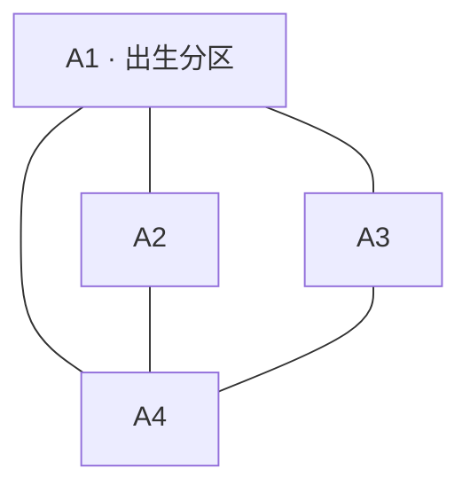

# 大型拼接地图玩法设计

创建日期：2026-10-25  
更新日期：2026-10-26（确定临时入口为“随机关卡 → 多区域关卡”）  
状态：已接入首个四区测试样例；本文保留确定规则及后续设计项。具体测试配置、当前临时数值、入口和验证记录见 [多区域关卡测试说明](MultiRegionTesting.md)。

## 1. 玩法概述

将 **4～6 张标准大小的关卡地图**拼合为一张大型战场。每张组成地图称为一个“分区”，例如 A1、A2、A3、A4。玩家驾驶一辆坦克，在其中一个分区出生，通过普通移动往返相邻分区，在同一场持续进行的战斗中完成一个共同胜利条件。

所有分区从开局起共同推进回合。玩家所在分区正常呈现战斗，其余分区持续按规则结算，但不播放行动，也不产生可供玩家查看的异地战报。小地图每回合开始时提供一次全图分区概况；当前分区达成共同胜利条件时立即结算，其它分区导致的胜利在回合最后的专用检定阶段结算。进入新分区时，镜头平移并以该分区为屏幕中心。

本文使用三种规则状态：

- **已确定**：用户提出的玩法要求，见第 2 节；各节标题中标为“已确认”的内容为补充确定规则。
- **草案约定**：为使方案可讨论、可验收而补充的建议，见第 4～10 节（其中已确认规则除外）；仍可调整。
- **待定**：存在明显分歧的玩法选择，集中列于第 11 节；不能作为已确认需求实现。

## 2. 已确定的核心规则

| 项目 | 规则 |
| --- | --- |
| 临时入口 | 在“随机关卡”列表中新增名为“多区域关卡”的关卡入口。 |
| 地图规模 | 由 4～6 张当前主流关卡大小的地图拼成一个大关卡；4 张地图为首个讨论示例。 |
| 地图关系 | 分区像拼图或地砖一样相邻拼接，形成可移动的连续战场。 |
| 地形来源 | 分为预制关卡与随机关卡两种。 |
| 随机地形衔接 | 生成时统筹所有分区，保证跨分区的道路、河流连续；本稿采用先生成完整大地图地形，再切分为各分区的方案。 |
| 出生 | 玩家坦克生成在其中一个分区，该分区为出生点分区，例如 A1。 |
| 友方编制 | 一个连队由 4 辆坦克与 4 个美军步兵单位组成；坦克通常为 2 辆谢尔曼、2 辆谢尔曼76。 |
| 玩家计入编制 | 出生分区的连队减少 1 辆普通 AI 谢尔曼，换为玩家谢尔曼，坦克总数仍为 4 辆。 |
| 默认友军部署 | 四区样例一般在 A1、A2 各部署 1 个连队。 |
| 默认敌军部署 | 敌方先默认为德军，在 A1～A4 均部署初始兵力，按分区战力预算随机生成；示例为 A1、A2 各 12，A3、A4 各 16。 |
| 初始出生区域 | 首版按双方各自出生区域简单制定初始部署，不先加入复杂的编成与部署平衡机制。 |
| 基础玩法 | 玩家在任一分区内游戏时，规则与普通关卡相同。 |
| 回合同步 | 每回合所有分区的 AI 单位均按规则行动，分区不会因为玩家不在场而暂停。 |
| 异地结算 | 非当前分区的 AI 行动直接处理效果，不播放其过程、音效，不产生异地战报；小地图在回合开始提供概况，后台战果参与回合末统一胜利检定。 |
| 战斗记录 | 每次只新增玩家当时所在分区的战斗记录；已经记录的亲历历史持续保留，切区不清空，也不按当前分区过滤旧记录。玩家不在场期间的异地战斗不记录、不补发。 |
| 单位跨区 | 其它分区的单位可以进入玩家所在分区；进入后纳入当前分区的正常呈现。 |
| 分区完全控制 | 一个分区内仅剩某一方的单位存活时，该分区视为被该阵营完全控制。 |
| 受控分区 AI 支援 | AI 不以无人区为最终目标，优先支援交战区；按路线使用合法骰子，允许穿过己方分区及无人区。目标只在失效、不可达或出现明确更高优先级情况时更换。 |
| 保留的战术行为 | 允许利用视野盲区牵制 AI、允许跨区撤退；首版不专门处理堵路或要求部队及时支援。 |
| 分区交战边界 | 首版不允许跨区射击，视野也不跨区显示。 |
| 回合随机事件 | 每个分区有自己的回合结束随机事件。 |
| 专用增援 | 本模式新增专用增援事件，仅在交战区或增援所属方完全控制的分区生成；空降兵事件仍可在敌控区生效。 |
| 随机增援数量门槛 | 同一区域同阵营单位数超过配置值 X 时，该方随机增援事件不生效；X 可先以 10 为例。 |
| 小地图 | 显示所有分区的四种状态与敌我战力对比，不显示具体单位和地形；敌控区敌方战力用“？”显示。每回合开始同步一次。 |
| 季节与天气 | 全部分区的季节相同、天气相同。 |
| 胜利条件 | 整个大关卡共用一个胜利条件，例如击杀 4 辆 4号G；友军击杀计入。当前分区达成立即结算，其它分区达成在回合最后的专用检定阶段结算；等待期间玩家被击毁则直接失败。 |
| 玩家跨区 | 使用普通移动进入相邻分区。 |
| 镜头 | 玩家进入新分区后，镜头平移，以新分区为屏幕中心。 |

## 3. 项目现状与尺寸基准

### 3.1 “标准大小”的当前含义

当前主流任务资源采用 **8 列 × 6 行的配置框架**；随机地图生成器也使用 `COLS = 8`、`ROWS = 6`。数组中的 `null` 表示不存在的格子，因此配置框架尺寸与实际可用格数并不相同。

新玩法以当前标准地图的占地与战术尺度为基准。“六边形关卡”指由六角格组成的分区轮廓，不能直接据此假设现有 8×6 轮廓是能够严格铺满平面的正六边形。

当前实现直接复用普通随机关卡的8列×6行、36个有效格轮廓，并以轴向平移 `(8,-4)`、`(-3,6)` 无重叠拼接。各区保持相同的行偏移、格子大小与镜头缩放，单区不再采用7行、37格的正六边形替代模板。

### 3.2 与现有战役的关系

现有战役采用三阶段连续推进，各阶段有自己的目标和阶段衔接处理。大型地图则在同一战局内保留全部分区、共同推进回合，并共享一个目标。

跨分区是一次普通移动引起的位置和观察范围变化，不能直接套用战役过关时的状态恢复、弹药补充、强化选择或下一阶段初始化。

### 3.3 当前可复用的规则依据

- [总策划案](GameDesignDocument.md)：普通回合流程、移动、AI、视野、天气与战报规则。
- [任务手册](Missions.md)：地图格、出生位置、增援编号与任务目标配置。
- [随机地图生成器](../assets/scripts/core/RandomMissionGenerator.ts)：当前标准尺寸与有效格轮廓。
- [单位配置](../data/units.csv)：示例中的“4号G”对应 `kind = panzer4`；`panzer4_f` 为“4号F”。
- [战役系统设计](superpowers/specs/2026-07-09-campaign-system-design.md)：已有地图拼接与镜头过渡的参考；不作为本玩法的阶段规则。

以上是现状参考，当前接入范围及测试配置以 [测试说明](MultiRegionTesting.md) 为准。

### 3.4 玩法入口（已确认）

入口暂时放在**随机关卡**列表内，新增一个关卡条目，显示名称固定为 **“多区域关卡”**。

进入路径：**随机关卡 → 多区域关卡**。

该入口启动本文描述的多分区随机大关卡，按整体生成地形再切分分区的规则创建战场，并使用本玩法的共同目标、兵力、同步回合、小地图与判胜规则。预制地图的入口及编辑器接入方式仍可后续确定。

## 4. 分区与地图拼接（草案约定）

### 4.1 地图结构

一个大关卡包含一组分区、一个玩家出生位置、一套共同环境和一个共同任务目标。每个分区保存属于本区的地形、初始单位、增援位置和事件表；地形的规划与生成需要统筹整个大关卡，不能因分区分别保存而失去连续性。

首个样例使用 A1～A4 四个分区。2026-10-31调整为两列交错拼接：左下A1（出生分区）、左上A2、右下A3、右上A4。下面表达实际相邻关系，连线不代表具体拼接坐标或实际轮廓：



样例可以在各分区分别放置 1 辆目标 4号G，也可以采用 2、1、1、0 等分布；不要求每个分区都有目标。

### 4.2 拼接约束

1. 每个有效六角格只属于一个分区，分区之间不得重叠。
2. 相邻分区的连接格必须在统一六角网格上真正相邻，不采用传送点代替普通邻接移动。
3. 配置中的不存在格不会因为拼接自动变成可通行地形；填补接缝必须明确配置地形与归属。
4. 道路、桥梁、河流与树篱的边界表现需要对齐；移动仍按实际地形规则判定。
5. 普通移动可以跨越任何合法的相邻分区格边，不额外要求踩到唯一出口。
6. 地图整体必须连通，并为玩家出生位置到任务必经位置提供合法通路。
7. 内部分区边界不作为撤离出口；大地图外缘是否允许撤离，由共同任务目标另行指定。

### 4.3 地形来源与连续性（已确认）

地形分为两种来源，均使用相同的分区、移动和同步回合规则：

| 来源 | 定义 | 衔接要求 |
| --- | --- | --- |
| 预制关卡 | 由设计者预先制作地形与分区布局，开局加载已制作的地图。 | 制作时检查相邻分区的道路、河流及其它边界地形，保证拼接一致。 |
| 随机关卡 | 开局生成整个大关卡的随机地形，再按分区范围拆分。 | 在大地图尺度统一规划道路与河流，保留跨区连续性。 |

随机地图不能简单地分别生成 A1、A2、A3、A4，再无约束地拼在一起。道路与河流应作为横跨分区的完整地形结构生成，不能在内部分区边界被截断或错位。道路自身规划的尽头、河流自身规划的源头等仍可存在，但不能由切分操作意外产生。

切分只是确定各格的分区归属，不改变已经生成的地形、格子邻接、道路连接方向或河流走向。季节与天气仍使用整个大关卡的共同配置。

预制地图也需要满足同样的连续性要求。若复用现有小关卡，应先检查并调整其接缝，不能默认任意两张现有地图都能直接匹配。

### 4.4 随机地形生成与切分流程（草案约定）

采用“**确定整体范围 → 生成完整地形 → 切分分区 → 校验**”的流程：

1. **确定范围**：先确定 4～6 个标准分区的轮廓、布局与格子归属，构成统一六角网格上的大地图有效范围。
2. **统一规划**：在整个有效范围内规划地形分布、河流路径与道路网络；这些结构可以自然穿越内部分区边界。
3. **完成地形**：按全图规划落地河岸、道路、桥梁、树林、建筑等细节。道路过河的位置需按地形与桥梁规则保持合法通行。
4. **切分数据**：按已确定的分区范围，将地形数据归入 A1～A6；保留各格与全图坐标的映射，以及跨区格边的连接关系。
5. **统一校验**：检查切分前后地形一致、接缝连续、格子无丢失或重复，以及任务必经路线可通行。
6. **配置战斗内容**：在合法地形上生成或放置出生点、单位、目标与增援点，并检查其可达性。地形来源不自动决定单位、目标和事件的配置方式。

例如，一条道路由 A1 延伸到 A2，再到 A4，应在生成时是一条连续路径；切分后各分区只保存对应路段，不在边界额外添加道路尽头。河流从 A3 流经 A1 再进入 A2 时同理，河道与河岸在两侧需要连续，不能在 A1 / A2 接缝突然变成陆地。

切分和渲染不能将内部分区边界误判为整张地图的外缘。道路连接、河岸轮廓、地形混合与桥梁端点都应读取边界另一侧的真实邻格；局部坐标转换后，六向连接仍须正确。

建议保存随机种子、生成器版本及生成后的完整地形与分区映射。读档和跨区移动使用已生成结果，不逐区重新随机生成。若校验失败，应回到全图规划修正或重新生成，不能仅重掷某一区而破坏已有衔接。

### 4.5 美军连队编制与玩家席位（已确认）

玩家一方配置 AI 友军。每个连队由 **4 辆坦克 + 4 个美军步兵单位**组成；常规坦克编制为 **2 辆谢尔曼 + 2 辆谢尔曼76**。这里的“连队”是本玩法的编制名称，“4 个步兵”指游戏内 4 个步兵单位。

| 单位 | 普通友军连队 | 玩家所在分区的连队（默认玩家驾驶谢尔曼） |
| --- | --- | --- |
| 玩家谢尔曼 | 0 | 1 |
| AI 谢尔曼（`sherman`） | 2 | 1 |
| AI 谢尔曼76（`sherman76`） | 2 | 2 |
| AI 美军步兵（`american_infantry`） | 4 | 4 |
| 合计 | 4 辆坦克、4 个步兵单位 | 4 辆坦克、4 个步兵单位 |

玩家坦克占用连队中的一个普通谢尔曼席位，不是在完整连队之外额外加入一辆车。其余坦克与全部美军步兵均由 AI 按对应单位规则行动，参与同步回合、分区控制与跨区支援。

“2 辆谢尔曼 + 2 辆谢尔曼76”为通常编制；如后续提供其它车辆组合，应显式配置。玩家改用其它型号时如何替换连队席位，另行定义。

### 4.6 默认部署与德军战力预算（已确认）

四分区样例一般在 **A1、A2 各部署 1 个美军连队**，玩家在 A1；德军在 **A1、A2、A3、A4 全部分区**部署初始兵力。

| 分区 | 美军初始兵力 | 德军初始战力预算（示例） |
| --- | --- | --- |
| A1 · 玩家出生分区 | 玩家谢尔曼 ×1、AI 谢尔曼 ×1、AI 谢尔曼76 ×2、美军步兵 ×4 | 12 |
| A2 | AI 谢尔曼 ×2、AI 谢尔曼76 ×2、美军步兵 ×4 | 12 |
| A3 | 默认无初始美军连队 | 16 |
| A4 | 默认无初始美军连队 | 16 |

该配置合计 **8 辆美军坦克（含玩家 1 辆）和 8 个美军步兵单位**，即 1 个玩家单位与 15 个友军 AI 单位；德军初始战力预算合计 **56**。

敌方兵力按各分区的战力预算随机组合，不固定为同一套单位或固定单位数。12、12、16、16 为当前四区示例配置，不是全部大地图必须使用的常量；默认敌方阵营为德军。

地形来源与兵力配置分别处理：预制地形也可以按上述预算随机配置德军，不因地图是预制关卡就自动固定敌军编成。

按当前控制规则，默认开局 A1、A2 为交战区；A3、A4 只有德军存活，属于德军完全控制分区，其中 AI 适用第 5.3 节的路线支援规则。

首版初始部署先按照双方出生区域简单制定：双方各使用自己的出生区域，在区域内按单位地形与占位规则落点。具体出生区域范围由地图模板或配置给出；不要求首版先实现复杂的编成协同、阵型或部署强度评估。A3、A4 默认只需要配置德军出生区域。

### 4.7 战力随机生成的约束（草案约定）

建议先为可选德军单位定义战力成本，再按每区预算生成初始编成，并在合法地形上部署：

- 每区初始单位的战力成本总和应等于该区配置预算；不能只满足全图合计，却把 A1 的预算挪到 A3。预算无法合法组合或部署时应修正配置或重新生成，不能静默少配。
- 共同目标要求的单位需要纳入生成约束，并建议计入其所在分区的初始战力预算，避免目标单位额外叠加而使实际预算失真。
- 现有随机生成器已有 `enemyThreatPoints` 与单位 `threat` 成本，可作为机制参考；本玩法是否沿用现有数值、单位池和抽取权重仍待确定。战力成本不是单位表中的火力属性 `firepower`。
- 现有欧洲随机池未列入示例目标的 `panzer4`（4号G）。若继续采用击杀 4 辆 4号G 的目标，需先定义其战力成本与目标生成方式，不能按缺省零成本处理。
- 初始战力预算约束开局编成，不自动表示每回合补足到该值；回合事件增援继续按独立事件规则执行。
- 生成后的单位编成、部署位置与随机状态需要保存，切区和读档不重新抽取。

## 5. 普通移动与跨区（草案约定）

### 5.1 玩家跨区流程

1. 玩家使用当前模式下的普通移动动作，目标格位于相邻分区。
2. 检查目标格、朝向、地形、桥梁、占位等条件，按普通移动消耗行动资源。
3. 移动成功后，以玩家坦克所在格的归属更新“当前分区”。
4. 镜头平移到新分区中心，按新分区刷新可见内容，并将后续战报的记录范围切换到新分区；保留已有战报历史。
5. 镜头稳定后，继续原回合和原行动子阶段，保留尚未使用的骰子。

跨区本身不额外结束回合，不重新摇骰，不恢复伤势，不补充弹药，也不重置其它分区。玩家可以按普通移动规则返回已到过的分区。

若单个动作包含多格位移，每一步都检查边界与地形；跨区不刷新该动作的剩余步数。遇到非法目标格时沿用原移动停止规则。

镜头平移期间暂停后续结算和战斗输入，避免玩家尚未看到新分区就发生下一次行动。平移时长作为表现参数调试，不预先固定为现有战役的过场时长。

### 5.2 AI 跨区流程

AI 使用同一套格子邻接与移动合法性判断，不因玩家所在分区而获得额外移动能力。

一个 AI 单位从 A2 进入当前分区 A1 时：

- A2 内已完成的行动不补播、不补记战报。
- 从进入 A1 的边界移动起，按当前分区与当前视野规则呈现。
- 进入后保留此前的装填、伤势、乘员、弹药及剩余行动状态。
- 不因为转入 A1 的单位列表而再次获得本阶段行动机会。

单位从 A1 离开后，其在其它分区的后续行动转为静默处理。若以后再次进入 A1，只呈现当时及之后的可感知行动。

### 5.3 受控分区 AI 的路线支援（已确认）

某分区被一个阵营完全控制后，本区 AI 选择其它战场并规划合理路线，按路线需要使用合法骰子转向与前进，可能跨越分区边界支援战斗。**不再仅以目标分区中心方向规定转向，而是先确定可行路线，再执行动作。** 玩家方友军 AI 与敌方 AI 均适用；玩家直接控制的坦克仍由玩家操作。

- **无人区不作为 AI 的支援或进攻目标。** 不会仅因己方撤出后原分区变为空区，就把它选作新的目标返回。
- **优先支援交战区。** 敌方完全控制的分区仍可作为进攻目标；无人区及己方完全控制区不作为最终作战目标。
- **允许经过己方分区。** 当全部相邻分区都由己方完全控制时，AI 可以穿过这些分区，前往更远的战场；搜索范围不局限于相邻分区。
- **允许穿过无人区。** 无人区可以成为通往其它战场的途经区域，只禁止把它作为最终作战目标。
- **动作服从路线与原有规则。** 根据路线、车体朝向与地形等条件使用现有合法骰子，不额外赠送移动或忽略障碍，也不保证本回合必定到达目标。
- **保持既定目标。** 只在目标失效、不可达或出现明确更高优先级情况时更换，不因每次行动重新比较出同级目标就反复折返。

例如 A1 已由玩家方完全控制，邻接的 A2、A3 也均由玩家方完全控制，而 A4 正在交战，则 A1 的友军 AI 可以规划经过 A2 或 A3 的路线前往 A4。A2、A3 是途经分区，A4 才是支援目标。

路线选择不赋予单位对其它分区具体敌军的视野；进入目标分区后按普通交战规则选择单位目标。支援单位进入玩家当前分区时，沿用第 5.2 节的呈现与行动次数规则；发生在其它分区的支援行动仍静默结算，不补发战报。

### 5.4 支援目标的选择细节（草案约定与待配参数）

- 建议根据真实结算状态选择路线，不将每回合只刷新一次的小地图显示快照作为寻路状态。本区变为交战区时恢复普通交战逻辑。
- 寻路检查格子邻接、地形、桥梁与占位条件，并把路线转换为当前朝向下可由合法骰子执行的动作；具体算法待定。首版不额外开发为堵路解围的避让、协调或分流机制。
- 初次选择时同优先级多个目标的排序、路线代价，以及“不可达”和“明确更高优先级”的具体判断参数，尚待确定；后续更换必须遵守第 5.3 节已确认的条件。
- 无合格或可达战场时如何行动、远方交战区与近处敌控区之间如何权衡，仍需定义。

### 5.5 保留的战术行为与首版取舍（已确认）

- **允许视野盲区牵制。** 利用盲区躲避 AI 是合法策略，不为消除这种策略而新增全知搜索、强制发现或强制清除残敌的规则。
- **不要求一定支援其它分区。** 支援不是主要目的；一个分区被一两个残余单位持续牵制，可以自然发生，不因此放宽完全控制条件或强制抽调部队。
- **允许跨区撤退。** 玩家和单位按普通移动跨区撤退，仍受“不跨区射击”的边界规则保护，不额外增加跨区追击射击或撤退惩罚。
- **堵路先不专门处理。** 仍遵守普通地形与占位规则；桥头、接缝或友军占位造成等待或停滞时，首版接受这种情况，不新增强制让路、挪位或专门的拥堵处理系统。

## 6. 全分区同步回合（草案约定）

### 6.1 一个共同回合时钟

大关卡只有一个回合号和一条阶段流程。玩家仍每回合获得一次普通关卡规定的行动流程，不按分区数量增加行动次数。

沿用所选游戏模式与战场现有的阶段顺序，包括烟雾处理、玩家行动、着火检定、友军 / 敌军 AI、回合随机事件，以及已配置的回合事件等。将原流程中需要处理的单位或分区范围扩展到整个大关卡，不改变原有规则适用对象。在这些阶段全部完成后，新增最后一个“胜利条件检定”阶段，见第 6.4 节。

例如原规则只要求玩家进行的着火检定，不应因为全图同步而自动新增为所有 AI 的着火检定。每回合开始还需同步一次第 7.4 节的小地图概况。

### 6.2 “同步”的结算含义

同步表示所有分区共同推进到同一回合与阶段，不要求所有单位在同一瞬间并发执行。

- 同一 AI 阶段中，全图符合规则的 AI 单位都获得对应行动机会。
- 按既有 AI 顺序规则生成全图行动序列，必要时使用稳定标识处理同序关系。
- 玩家是否观察该分区只影响表现，不改变行动机会、骰子、目标判断和伤害规则。
- 非当前分区直接完成规则结算，不等待移动动画、掷骰动画、音效或结果弹窗。
- 所有分区本阶段完成后，才推进到下一阶段。

阶段开始时确定参与单位，并记录本阶段已行动状态。单位跨区后不得重复行动；阶段中生成单位何时获得首次行动机会，沿用普通关卡规则。

### 6.3 持续保留战场状态

全部分区从开局起初始化，未进入的分区也参与模拟。不能等玩家首次进入才生成单位或补算此前回合。

玩家返回旧分区时，应看到经过实际战斗后的现场，包括单位位置、残骸、地形破坏、烟雾、弹药和单位状态；限时效果仍按原规则到期。

### 6.4 当前分区即时判胜与回合末胜利检定（已确认）

共同胜利条件仍只有一套，按**使条件达成的行动实际发生时，是否位于玩家当前分区**区分结算时机：

| 情况 | 结算方式 |
| --- | --- |
| 在玩家当前分区达成共同胜利条件 | 立即结算大关卡胜利，停止后续战斗流程，不等回合结束。 |
| 在其它分区达成共同胜利条件 | 累计实际战果并继续本回合，在最后的专用胜利条件检定阶段再结算。 |
| 异地条件已达成，但玩家在本回合最后检定前被击毁 | 直接失败，不因异地战果已经达成而提前获胜或获得保护。 |

友军击杀同样计入目标；当前分区的即时结算不要求一定由玩家亲自完成最后一击。各分区此前累计的战果可共同构成目标，例如前三个目标在异地被击毁、最后一个在当前分区被击毁，则本区这次行动使共同条件达成，立即结算胜利。

回合最后保留专用**胜利条件检定阶段**，处理尚未结算的异地胜利：

```text
回合中：当前分区达成条件 → 立即胜利；玩家被击毁 → 直接失败
战局尚未结束 → 完成剩余普通回合阶段（含各分区 AI 与事件）
→ 最后的胜利条件检定
→ 共同条件已达成：结算大关卡胜利
→ 未达成：进入下一回合，并在回合开始同步小地图
```

例如玩家在 A1，A2 的友军已击毁最后一个任务目标：本次异地战果暂不结算胜利；若随后玩家在同回合被击毁，直接判负。若战局持续到回合最后且条件满足，才结算胜利。

异地战果不能仅因玩家随后切区或执行一次无关本地动作，就被重新认定为“当前分区达成”而提前判胜。失败条件及其检查方式仍沿用普通规则，不将失败检定推迟到回合末。

## 7. 呈现、视野与战报（草案约定）

### 7.1 两层信息判断

先判断内容是否属于当前分区，再应用普通关卡在当前模式下的视野规则。处于当前分区并不代表硬核模式下所有单位都可见。

| 内容 | 当前分区 | 非当前分区 |
| --- | --- | --- |
| AI 规则结算 | 正常执行 | 正常执行 |
| 可感知行动动画、特效和音效 | 按普通关卡视野规则显示 | 不播放、不发声 |
| AI 骰子和结果弹窗 | 沿用普通关卡允许的反馈 | 不显示 |
| 战斗记录 | 新增当前分区符合规则的记录；历史中保留玩家此前在其它分区亲历的记录 | 玩家不在场期间不新增记录，之后进入也不补发 |
| 镜头跟随 | 只围绕当前分区内允许呈现的行动 | 不自动切过去 |
| 单位攻击预览、名称及交互 | 按当前模式的可见性规则 | 不暴露异地实时单位信息 |

镜头平移途中即使扫过其它分区，也不能提前泄露其中的战斗动画、单位状态或战报。全图概况通过第 7.4 节的小地图提供，不因此开放异地战术视野。

### 7.2 战报的记录边界与历史保留（已确认）

战报按玩家在整个大关卡中的经历连续累积。**“只记录当前分区”约束的是每条新记录的产生范围，不是历史列表的显示范围。**

1. 每条新战报按行动实际发生时的分区与玩家当时所在分区判断是否记录，同时遵守普通关卡的记录规则。
2. 玩家切换分区时，不清空已记录的战报，也不隐藏此前在其它分区亲历的记录。
3. 所有已记录内容按实际发生顺序保留在同一条历史中，可跨回合、跨分区回看。建议每条记录标明回合与分区，便于辨认。
4. 玩家不在某分区期间，该分区的战斗不产生玩家战报；玩家之后进入或返回该分区时，不补发、不补记缺席期间的记录。

已确认示例：玩家第 1～10 回合在 A1，第 11～15 回合在 A2。第 15 回合查看战斗记录时，显示 **第 1～10 回合在 A1 已记录的内容，以及第 11～15 回合在 A2 已记录的内容**，按发生顺序连续排列。A2 第 1～10 回合及 A1 第 11～15 回合的异地战斗不进入该历史。

若玩家第 16 回合返回 A1，保留上述全部亲历记录，并继续追加第 16 回合起在 A1 符合规则的新记录；不补记离开 A1 期间的战斗。

示例：玩家在 A1 时，A2 的坦克击毁一辆友军，不产生玩家战报；随后该坦克驶入 A1，只记录它进入 A1 后符合显示规则的行动。玩家之后进入 A2，也不会获得此前那次交火的补发记录。

开发调试记录可另行保留，但不得进入玩家战报、历史详情、结果回看或玩家可调用的战斗记录接口。

### 7.3 跨分区射击与视野（已确认）

首版**不允许跨分区射击，视野也不允许跨分区显示**。该限制对玩家、友军 AI 和敌方 AI 同样适用。

- 攻击者与目标必须处于同一分区，再按普通关卡的射程、朝向、视野和遮挡规则判断；即使隔着边界相邻，也不能直接射击。
- 单位视野裁切在其所属分区内。来自其它分区的无线电视野不能使玩家看见异地具体单位或地形。
- 单位可以通过合法普通移动跨区，进入后立即按新所属分区判断视野与攻击资格，无需等到下一回合。
- 小地图的分区状态与战力概况是单独规定的信息，不等同于获得该分区的战术视野，也不能用于直接选择异地攻击目标。

### 7.4 分区小地图（已确认）

新增小地图，以简化分区块显示所有区域的概况。**不显示具体单位、单位位置或地形**，只显示分区状态与该区敌我战力对比。

状态以玩家方立场显示，分为“无人区 / 己方控制 / 敌方控制 / 交战中”；四种状态的实际判定见第 9.3 节。“交战区”与“交战中分区”为同一概念。

| 同步时的分区状态 | 己方战力 | 敌方战力 |
| --- | --- | --- |
| 无人区 | 0 | 0 |
| 己方控制 | 该区己方战力 | 0 |
| 敌方控制 | 0 | **？** |
| 交战中 | 该区己方战力 | 该区敌方战力 |

**每回合开始时，统一同步一次所有分区的状态与战力快照。** 本回合内单位移动、伤亡、增援与控制变化不实时刷新小地图；跨区或打开小地图也不额外刷新。下一回合开始时才整体更新。

因此，小地图可能暂时保留上一同步节点的局势，这是既定的信息更新方式。后台真实状态照常结算；当前分区达成立即结算、异地达成回合末检定，均不通过刷新小地图触发判胜。

显示“？”时，战力条、比例或其它小地图表现也不能泄露隐藏数值。小地图概况不产生异地战报，不回放异地战斗。

战力的具体统计公式、玩家和友军的战力成本，以及伤势是否影响显示值，仍需确定；显示应统计同步时该区实际兵力，不能把初始预算 12 / 16 当作永久剩余战力。

## 8. 分区回合结束事件（草案约定）

每个分区保存自己的事件表和独立抽取结果；同一回合各分区分别执行一次其规则规定的随机事件流程，不能共用一次掷骰结果，也不能只处理当前分区。

### 8.1 事件作用范围

| 事件类型 | 草案处理建议 |
| --- | --- |
| 步兵、坦克等普通增援 | 使用本模式专用增援事件，区域资格执行第 8.3 节已确认规则；具体落点使用所属分区合法增援位置，其它分区同号点位不参与选择。 |
| 空降兵 | 保留在敌控区生效的能力，见第 8.3 节；具体落点与交互继续按空降规则判断。 |
| 分区内单位行动或地形变化 | 在所属分区内按原规则执行；非当前分区静默结算。 |
| 地雷、机械故障、狙击手、车长额外行动等明确针对玩家的事件 | 建议仅在玩家位于事件所属分区、且原触发条件成立时生效；玩家不在时本次事件无效果，不重掷、不累积。此项待确认。 |
| 需要玩家选择的事件 | 仅在事件实际合法作用于玩家时打开交互，避免非当前分区弹出远程选择。 |
| 改变天气或季节的事件 | 如后续纳入，必须更改共同环境；不能只改变一个分区。首版是否允许此类事件另定。 |

“各分区拥有自己的事件”不等于复制多辆玩家坦克。非当前分区事件不能错误地索引远处的玩家，导致玩家在同一回合收到多次异地故障或车长奖励。

### 8.2 事件推进与新增单位

各分区事件使用固定、可保存的结算顺序，例如按 A1～A6。该顺序不因当前观察分区变化，避免切区改变随机结果。

新生成的单位立即加入实际战场；是否在本回合继续行动，服从事件及普通关卡原有时序。不能为追赶其它分区进度而补发一次 AI 阶段。

已有“每回合 / 指定回合执行”的非随机事件如需复用，建议读取共同回合号；不会因玩家首次进入分区而从第 1 回合重新计时。

### 8.3 大地图专用增援事件（已确认）

本模式新增专用增援事件。**普通增援仅能在交战区，或该增援所属阵营完全控制的分区生成。** “己方”相对于增援所属阵营判断，不固定指玩家方。

| 目标分区实际状态（相对于增援所属方） | 普通增援资格 |
| --- | --- |
| 己方完全控制 | 允许。 |
| 交战中 | 允许。 |
| 对方完全控制 | 不允许。 |
| 无人区 | 不允许。 |

**空降兵事件仍可以在敌控区生效**，是上述普通增援限制的例外；其它空降触发条件与落地规则继续适用。不能将普通增援的区域限制直接套到空降兵事件。

事件实际执行时检查后台真实控制状态，不使用可能已过时的小地图快照。增援进入后参与正常单位与分区状态结算；小地图仍等下一回合开始才同步。

专用增援的概率、单位构成、规模、落点以及条件不满足或无合法位置时的处理仍待配置。不得直接沿用原单关增援，使普通德军在玩家完全控制区生成，或使普通美军在德军完全控制区生成。空降兵在无人区是否生效不由本条新增确认。

### 8.4 随机增援的单位数量门槛（已确认）

随机事件的增援设置单位数量上限参数 **X**，例如先配置为 **10**。执行某方在某分区的随机增援事件时，检查**该分区内该阵营的实际存活单位总数 N**：

- **N > X：该次增援事件不生效，不生成单位。**
- **N ≤ X：不因本门槛阻止事件，继续检查区域资格、落点等其它条件。**

例如 X=10 时，该分区已有同方单位 11 个，该方增援事件不生效；已有 10 个时尚未“超过 X”，不会仅因本门槛取消增援。

统计按分区与战斗阵营分别进行，不使用全图单位总数，不混入对方单位，也不以初始编制替代当前数量。坦克与步兵均按游戏单位计数；玩家坦克也属于玩家方单位。特殊对象的统计资格仍见第 11 节。

这是随机增援事件的生效条件，不限制正常跨区移动或既有初始部署。随机事件触发的空降增援同样检查数量门槛；其在敌控区可生效的区域例外继续保留。非随机事件产生的增援是否使用同一门槛另行配置。

门槛按事件执行时的实际数量检查，小地图显示快照不参与判断。增援批次规模及是否逐个检查 / 截断到某个数量尚未规定，不能擅自把用户确定的“超过 X”改成“大于等于 X”。

## 9. 共同目标、环境与分区控制（含已确认规则与草案约定）

### 9.1 一个共同胜利条件（含已确认的友军战果与分区判胜时机）

首个示例目标为：**在整个大关卡累计击杀 4 辆敌方 4号G**。

- 目标可以分布在多个分区，击杀后累计到同一个进度。
- 单位移动到别的分区后仍保持身份，不能因跨区清零或重复计数。
- 玩家及友军 AI 击杀任务目标均计入任务进度，不要求由玩家亲自完成最后一击。
- 消灭某个分区的全部对方单位后，若该分区仍有己方单位存活，则己方完全控制该分区；分区控制本身不单独结算大关卡胜利，也不要求先控制当前分区才能离开。
- 使共同条件达成的行动发生在玩家当前分区时，立即结算胜利；发生在其它分区时，在回合最后的专用胜利条件检定阶段结算，不要求玩家进入目标所在分区。
- 不额外要求逐区完成任务或撤离，除非共同目标明确配置。
- 玩家被摧毁或满足普通规则中的失败条件时，整个战局失败；即使其它分区已经达成目标，只要尚未到回合末检定、玩家先被击毁，仍直接失败。其它胜负冲突优先级沿用现有规则。

“累计击杀 4 辆某型号”与现有“该型号全部消灭”目标的含义可能不同。实现时需明确目标使用数量还是指定单位集合，不能直接以当前分区敌军列表判断胜利。

友军击杀计入、当前分区即时判胜与异地胜利回合末检定已经确定。同型增援是否计入、弃车是否等同击杀、其它原因摧毁以及未达成胜利前的进度数字如何显示，见第 11 节。判胜不补发异地战报，也不回放后台战斗。特殊目标退出或改变归属是否可能影响任务完成，先列入第 13 节观察项，不提前新增处理机制。

### 9.2 共同季节与天气

季节、积雪外观和天气由大关卡统一确定，所有分区使用相同结果。不能让各分区独立从天气池抽取，产生 A1 晴天、A2 雨天。

天气对命中、视野等的影响沿用当前规则，并在后台分区同样生效。跨区不会重新抽取天气，也不会因为季节外观变化而自动附加新的移动规则。

若后续允许环境在局内变化，应在同一结算节点更新所有分区。

### 9.3 分区状态与完全控制（已确认）

**单个分区内，如果仅剩某一方的单位存活，该分区即视为被该阵营完全控制。** 每个分区分别判定，不要求其它分区也由同一方控制。

| 分区内的存活单位 | 控制判定 |
| --- | --- |
| 仅有玩家方单位 | 玩家方完全控制。 |
| 仅有敌方单位 | 敌方完全控制。 |
| 双方均有存活单位 | 交战中（交战区）。 |
| 没有任何一方存活单位 | 无人区。 |

控制判定依据分区内实际存活单位，不依赖玩家是否在该分区或能否看见这些单位。“交战中”不要求此刻已经开火或双方已经互相发现。后台分区实际状态同样随战况更新，对玩家公开的概况则按第 7.4 节每回合开始同步一次。

“方 / 阵营”按战斗敌我归属区分，不按单位国籍区分。玩家坦克与同方友军归入同一方。

例如 A2 原本有双方单位，最后一辆敌方坦克被摧毁后，若仍有玩家方单位存活，A2 即满足玩家方完全控制条件；即使玩家坦克当时在 A1，也适用同一判定。

### 9.4 控制状态的更新与边界情况（草案约定）

在已确认的四种状态基础上，补充以下结算建议：

- 全部己方单位离开后，若本区无人则标为无人区，不因历史占领保留当前完全控制状态；AI 不以该无人区为作战目标。
- 在开局部署以及单位被摧毁、跨区移动、增援入场或阵营改变的一次完整规则效果结算后，重新判定受影响分区，不只在回合结束时检查。
- 敌方单位进入已完全控制的分区时，若原控制方仍有存活单位，则转为交战中；若原控制方已无存活单位，则按实际剩余单位重新判定。
- 统计建议涵盖本区各类存活作战单位。受损、起火或瘫痪但仍存活且有战斗归属的单位继续计入；残骸不计入。弃车、无人操炮武器等特殊对象的资格另行确认，不能只检查 `destroyed` 字段。

分区完全控制仍处于共同回合流程中，不暂停模拟，并按第 5.3 节触发路线支援、按第 8.3 节决定普通增援资格。其它事件变化或控制收益没有新增规定。

## 10. 状态与存档要求（草案约定）

这里定义玩法需要保留的状态，不预先限定实现接口：

| 范围 | 必须保存的内容 |
| --- | --- |
| 大关卡 | 地形来源、分区数量与拼接关系、全图坐标与分区映射、游戏模式、共同回合和阶段、共同环境、目标及其进度、随机状态；如异地战果已达成且正在等待回合末检定，需保留该结算状态，读档不提前判胜。随机地图另保存生成种子、生成器版本及已生成地形。 |
| 分区 | 地形及其变化、初始连队配置、敌军初始战力预算与实际生成编成、事件表 / 事件进度、增援点、增援数量门槛 X、烟雾及其它限时状态；控制状态按存活单位及战斗归属恢复并校验。 |
| 单位 | 全局唯一身份、位置与所属分区、朝向、车组、弹药和装填、伤势、状态、本阶段行动进度，以及保持中的支援目标和必要路线进度；读档不应无故重新选择同级目标。 |
| 玩家 | 当前分区、坦克完整状态、当前行动子阶段、剩余骰子和未完成选择。 |
| 呈现 | 镜头对应分区、跨回合跨分区累积的亲历战报历史，以及最近一次小地图状态与战力快照、对应同步回合；读档不以实时状态替换本回合快照。 |

存档应覆盖全部分区，读档后不能重新生成未进入分区或重掷已完成事件。首版建议只在规则允许的稳定结算节点保存；恢复时直接将镜头对准玩家所在分区，不通过重播后台行动恢复状态。

## 11. 待定设计项

下列项目保留为决策点。本稿给出建议方向，不将其视为用户已经确认的新增规则。

| 待定项 | 本稿建议 / 需要明确的内容 |
| --- | --- |
| 分区轮廓与具体布局 | 首先验证当前 8×6 有效格轮廓能否铺接，再确定标准模板和四区样例；六区沿用相同拼接约束。 |
| 初始部署细节与扩展 | 首版按双方出生区域简单部署已确定；出生区域的具体范围、非标准玩家车型的席位替换，以及 5～6 分区时的友军连队分布和敌军预算仍需配置。 |
| 德军单位战力表 | 确认各单位战力成本、随机池、抽取权重和编成限制；是否沿用现有 `threat` 数值，以及共同目标单位如何占用预算。 |
| AI 寻路参数 | 无人区允许途经、禁止作为最终目标，以及只在失效 / 不可达 / 明确更高优先级时换目标已确定；初次同级目标选择、远近取舍、路线代价与无可达目标时的默认行为仍需配置。首版不新增拥堵处理。 |
| 针对玩家的异地事件 | 建议玩家不在该分区时无效果，不重掷、不递延；也可另做适合无玩家场景的专用事件表。 |
| 专用增援配置 | 区域资格、空降例外及同区同方 N>X 时不生效已确定；X 的正式数值、事件概率、规模、单位池、落点、批次计数方式、区域不合格或无合法位置时的处理，以及空降在无人区是否适用仍待定。 |
| 任务击杀统计 | 玩家与友军 AI 击杀均计入已确定；其它原因摧毁、弃车与接管的统计口径仍需定义。 |
| 目标集合 | 明确是固定 4 个指定目标，还是累计击杀任意 4 辆 `panzer4`；后者还需明确增援是否计入。 |
| 目标信息可见性 | 当前分区即时判胜、异地达成回合末检定已确定；任务目标是否开局公开分布、未完成时进度数字的刷新方式仍需定义。 |
| 分区统计中的特殊单位 | 弃车、无人操炮武器等对象是否参与控制与战力统计，见第 9.4 节建议口径。 |
| 小地图战力公式与表现 | 全图四状态、敌我战力对比、敌控区敌方“？”、每回合开始同步一次已确定；各单位战力成本、伤势修正以及文字 / 条形的具体表现待定。 |
| 模式与后续入口 | 临时入口“随机关卡 → 多区域关卡”已确定；首版支持经典、硬核还是两者，以及预制地图入口和编辑器配置方式仍待定。本文不自动沿用战役的硬核限制。 |

## 12. 首个样例与验收场景

首个四区样例采用第 4.5～4.6 节的默认兵力：A1、A2 各 1 个美军连队，A1 的玩家占用一个谢尔曼席位；德军在 A1～A4 均登场，初始战力预算分别为 12、12、16、16。使用共同季节和天气，共同目标仍以击杀 4 辆 4号G 为例；具体敌军编成待战力成本与目标生成约束确定后随机生成。

以下场景是后续实现的验收依据，待定项先确认后再补充对应预期：

| 场景 | 预期 |
| --- | --- |
| 在随机关卡列表查找本玩法 | 显示名为“多区域关卡”的入口，进入后启动多分区随机大关卡。 |
| 默认 A1 连队部署 | 1 辆玩家谢尔曼、1 辆 AI 谢尔曼、2 辆 AI 谢尔曼76、4 个美军步兵；坦克总数为 4，玩家不额外占第 5 辆。 |
| 默认 A2 连队部署 | 2 辆 AI 谢尔曼、2 辆 AI 谢尔曼76、4 个美军步兵；全由 AI 控制并持续参与后台战斗。 |
| 检查四区敌军初始编成 | 默认均为德军，各区均有敌军；按最终战力成本表分别满足 12、12、16、16 的预算，不只检查全图合计 56。 |
| 检查双方初始落点 | 按各自出生区域简单部署，并满足地形与占位规则。 |
| 检查默认开局控制状态 | A1、A2 为交战区；A3、A4 由德军完全控制，其中 AI 规划路线，优先支援交战区。 |
| 加载预制大型地图 | 按预制地形与布局生成各分区，接缝满足道路、河流及其它地形的连续性要求。 |
| 道路或河流跨越多个随机分区 | 先在完整大地图生成连续结构；切分后走向、连接方向与地形保持一致，不因分区边界断开。 |
| 检查随机地图切分前后 | 全部有效格一一对应且无重叠、无遗漏；全图邻接与跨区通行关系不变。 |
| 查看道路、河岸或桥梁的分区接缝 | 使用另一侧真实邻格处理连接与外观，不出现人为道路尽头、假河岸或错误桥梁端点。 |
| 玩家在 A1 结束一回合 | 所有分区符合规则的 AI 都获得行动机会，全部推进到同一回合。 |
| A2 内发生交火 | 实际处理命中、伤害和单位状态；A1 不出现异地骰子、弹窗、音效、镜头跳转或战报。 |
| 玩家之后进入 A2 | 看到已结算的实际现场，不重置单位，也不补播异地交火。 |
| 玩家普通移动跨越 A1 / A2 接缝 | 沿用普通移动消耗，保留剩余骰子与阶段，镜头平移并以 A2 为中心。 |
| 玩家原路返回 A1 | 保留真实战场演变；不存在过关恢复、弹药补充或强化选择。 |
| 玩家射击后通过合法移动撤入另一分区 | 允许撤退；原分区敌军不能跨区射击，不额外施加撤退惩罚。 |
| 第 1～10 回合在 A1，第 11～15 回合在 A2 | 第 15 回合的战报历史同时保留第 1～10 回合 A1 与第 11～15 回合 A2 已记录的内容；不包含玩家缺席期间的异地记录。 |
| 第 16 回合返回 A1 | 保留此前 A1 与 A2 的全部亲历记录，继续追加 A1 的新记录，不补记第 11～15 回合 A1 的异地战斗。 |
| AI 从 A2 进入 A1 | 从进入当前分区起按普通可见性呈现；其此前行动不补播，本阶段行动不重复。 |
| 两个单位隔着分区边界相邻 | 不允许跨区射击，不显示跨区视野；合法跨区移动仍可执行。 |
| 单位通过移动进入另一分区 | 按新所属分区立即判断视野和攻击资格，仍使用原有剩余行动资源。 |
| 四分区回合结束事件 | 分别按各自事件表抽取和执行，各分区同号增援点互不混用。 |
| 专用普通增援尝试在不同分区生成 | 仅在交战区或增援所属方完全控制区允许生成；无人区及对方完全控制区不允许。 |
| 美军普通增援与空降兵分别作用于敌控区 | 普通增援不能生成；空降兵保留在敌控区生效的资格，继续检查原有空降条件。 |
| 本回合实际控制状态与小地图不一致 | 增援资格按实际状态判断；小地图快照不实时改变。 |
| X=10，同区同方已有 11 个存活单位 | 该方随机增援事件不生效，不生成单位；不受另一方单位数影响。 |
| X=10，同区同方恰好有 10 个存活单位 | 本数量门槛不阻止增援，继续检查区域、落点等条件；不擅自改为 N≥X 禁止。 |
| 切换分区或关闭表现 | 在相同规则状态与随机状态下，不能改变实际战斗结算结果。 |
| 某分区仅有一方单位存活 | 该方完全控制该分区；玩家是否在场不影响实际判定。 |
| 消灭最后一个敌方单位且仍有友军存活 | 该分区由玩家方完全控制，仍按共同目标判断大关卡是否胜利。 |
| 己方完全控制 A1，相邻 A2 交战、A3 无人 | AI 优先为 A2 规划支援路线，不以 A3 为作战目标；按路线使用合法骰子。 |
| 相邻分区全部为己方控制，更远 A4 正在交战 | 允许规划穿过己方分区到 A4 的路线，不因只检查相邻分区而停止支援。 |
| 通往目标战场的路线需要经过无人区 | 允许途经，最终目标仍是有效战场，不把无人区本身设为终点。 |
| 已有有效可达目标，出现另一个同级目标 | 保持原目标；仅在失效、不可达或明确更高优先级情况出现时允许更换。 |
| 残余敌军处于视野盲区，分区长期交战 | 允许牵制持续，不增加强制搜索、全知发现或强制抽调支援规则。 |
| 桥头或接缝被友军占位堵住 | 遵守普通占位与移动规则，首版接受等待或停滞，不要求新增拥堵解围机制。 |
| 敌方完全控制某分区且存在可支援战场 | 敌方 AI 适用相同的无人区排除、交战区优先与路线支援规则，不固定追踪玩家所在分区。 |
| 支援单位跨区进入玩家所在分区 | 按普通可见性呈现进入及后续行动，不补播此前异地行动，也不重复获得本阶段行动机会。 |
| 敌方进入仍有玩家方单位驻留的受控分区 | 实际状态转为交战中，不再满足玩家方完全控制条件；小地图等下一回合开始同步。 |
| 分区无任何一方存活单位 | 标为无人区，AI 不以此区为最终目标，普通增援也不能在此生成。 |
| 跨区目标单位被摧毁 | 根据最终确定的计数口径只累计一次，不受其出生分区或死亡分区影响。 |
| 友军 AI 击杀任务目标 | 同样计入共同目标，与玩家亲自击杀适用相同的目标身份与去重规则。 |
| 最后一个目标在当前分区被玩家或友军击毁 | 立即结算共同胜利，停止后续战斗流程，不等待回合末。 |
| 最后一个目标在非当前分区满足完成条件 | 正常累计战果，继续本回合后续流程；在最后的胜利条件检定阶段判断，不补发异地战报。 |
| 异地目标已完成，玩家在同回合末检定前被击毁 | 直接失败，不结算胜利。 |
| 异地已达成目标，玩家随后切区或执行无关本地动作 | 不改变这次达成的异地属性，不借此提前结算胜利。 |
| 等待异地胜利检定期间保存并继续 | 恢复本回合进度，保留玩家仍可能失败的状态，不在读档时直接结算胜利。 |
| 战局未结束并到达回合最后的胜利条件检定阶段 | 满足共同条件则结算胜利；未满足则进入下一回合并同步小地图。 |
| 每回合开始查看小地图 | 显示全部分区的无人区 / 己方控制 / 敌方控制 / 交战中状态及战力概况，不显示具体单位或地形。 |
| 同步时某分区为敌方控制 | 其敌方战力显示“？”，条形或比例等表现不能泄露数值。 |
| 回合内跨区、交战、增援或重新打开小地图 | 小地图保持本回合开始的快照，下一回合开始才统一更新状态与战力。 |
| 在四个分区间移动 | 季节、积雪与天气始终一致，天气规则在所有分区生效。 |
| 保存并继续 | 全部分区状态、共同回合、亲历战报及本回合小地图快照恢复一致，不重掷事件、不重复 AI 行动，也不借读档获取更新的全图情报。 |
| 扩展为 6 个分区 | 保持同样的同步、移动、目标、事件及呈现规则，不将第 5、6 分区作为特殊流程。 |

## 13. 试玩验证项（已确定先验证、再调整）

以下方面先通过样例验证或观察，不提前加入额外机制：

| 验证方向 | 重点观察内容 | 调整时机 |
| --- | --- | --- |
| 玩家对全局的作用 | 玩家能否及时到达需要支援的分区、路线选择是否影响战果，以及等待友军是否经常足以完成任务。 | 待实际验证后再决定是否调整兵力、目标分布或 AI 行为。 |
| 战斗节奏与整局长度 | 当前分区单位集中后的动画等待、后台结算耗时、连续赶路回合以及整局时长。 | 待实际验证后再决定加速表现、路线或其它节奏调整。 |
| 任务特殊情况 | 目标弃车、被接管或其它退出敌方的情况是否造成任务难以完成或无法完成。 | 待观察，当前不提前新增补发目标、替代目标或补偿机制。 |
| 小地图侦察收益 | 少量友军进入敌控区并存活到下一回合后，交战区显示全区战力所带来的侦察收益。 | 待观察，当前保留已有小地图规则。 |

首轮验证使用同一套四区配置与可复用随机种子比较不同玩家路线；记录结果用于讨论，不将尚未验证的风险直接改成新的限制或资源系统。

首个四区测试样例已接入。后续继续验证剩余配置与观察项，当前实现与临时测试数值见 [测试说明](MultiRegionTesting.md)。
