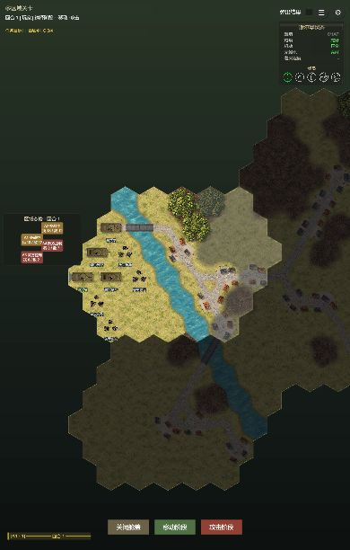

# 多区域关卡：首个测试样例

日期：2026-10-26。对应玩法规则见 [大型拼接地图玩法设计](LargeMapGameplayDesign.md)。

## 进入方式

在 Cocos Creator 3.8.8 预览项目，进入 **关卡 → 随机关卡 → 多区域关卡 → 进入关卡**。

首轮建议选择硬核模式，以检查坦克装填、德军步兵行动与战争迷雾。入口也接受现有经典 / 测试模式，不改变其它关卡的模式偏好。

当前入口每次新开局使用新种子，随机生成完整大地图的道路、河流、桥梁、林地、泥地、村庄与敌方编成；种子写入任务配置，便于复现。继续游戏恢复已保存的地图和随机状态。该入口使用配置中的玩家谢尔曼，不用菜单的车型偏好改写连队席位。更新前的存档保留原地图；需要新开局才能采用新的标准轮廓。

## 样例配置

| 分区 | 美军初始编制 | 德军初始战力 |
| --- | --- | --- |
| A1 | 玩家谢尔曼 1、AI 谢尔曼 1、谢尔曼76 2、美军步兵 4 | 12 |
| A2 | AI 谢尔曼 2、谢尔曼76 2、美军步兵 4 | 12 |
| A3 | 无 | 16 |
| A4 | 无 | 16 |

共同目标为累计击毁 **4 辆4号G**，每区开局各配置一辆，并计入所在区预算。其余德军在三号、四号F、三号突击炮和德军步兵中随机组合。当前增援不生成额外4号G。

初始部署按车辆、步兵分别占位：车辆之间不重叠，步兵小队之间使用独立位置；步兵可以与本方车辆（含玩家坦克）同格，仍作为独立步兵参战。友方初始坦克避开玩家出生朝向的正前方相邻格，该格可以部署步兵。

环境统一为欧洲夏季、晴天。小地图回合开始时更新，敌控区的敌方战力显示“？”。每区直接复用普通随机关卡的 **8列×6行、36个有效格** 轮廓，各行有效列范围为 `[2,6]、[1,6]、[1,7]、[0,6]、[1,6]、[1,5]`。轴向平移 `(8,-4)` 与 `(-3,6)` 无重叠拼接，保持各区行偏移相同；四区合计144格，镜头缩放与标准地图相同。

完整地形先统一生成，再赋予分区归属。道路随机连接各分区及全图边界，河流随机选择贯穿方向和位置，桥梁保持直线跨河；跨区道路与河流共用同一份连接数据。林地、泥地按片区生成，村庄偏向道路。部署后检查陆路可达性，避免随机地形把初始部队封在孤立位置。

下列战力成本为首轮测试值，不表示已完成平衡：

| 单位 | 战力 |
| --- | --- |
| 谢尔曼 | 3 |
| 谢尔曼76 | 4 |
| 美军步兵 / 德军步兵 | 1 |
| 三号坦克 | 2 |
| 四号G / 四号F / 三号突击炮 | 3 |

小地图按当前存活作战单位的上述成本累计，不因受损减值。残骸、弃车与附属操炮兵不重复计入控制和战力；载车步兵仍作为其阵营的单位计数。

## 分区随机事件

每回合结束，各区分别掷2d6。当前样例各区使用相同表，但独立抽取；配置支持分区分别改表。

| 合计 | 事件 |
| --- | --- |
| 2～3 | 美军步兵增援1个 |
| 4～5 | 德军步兵增援1个 |
| 6～7 | 无事件 |
| 8 | 美军谢尔曼增援1辆 |
| 9 | 德军三号坦克增援1辆 |
| 10 | 美军空降支援，沿用现有空降落地与反击规则 |
| 11～12 | 无事件 |

普通增援检查事件所属方的区域资格；空降保留敌控区例外。随机增援执行前，若同区同方存活作战单位数 **大于10**，本次不生效；等于10时仍可检查其它条件。地面增援从本方配置的出生区域选择合法空格，没有合法位置则本次取消，不递延或重掷。空降沿用现有合法落点选择，可能一次投放多个步兵。

本区空降播放现有空降流程；异地空降静默处理落地和反击。其它增援在本区出现时显示结果，异地不生成战报。

## 重点测试

1. 结束玩家回合：A2 同样作战，A3 / A4 的德军按合法骰子与路线支援；不自动切镜头或播放异地骰子。
2. 跨区移动：保持骰子与车辆状态，镜头平移到新分区中心；返回旧区看到已演变的现场。
3. 靠近边界：允许跨区移动和撤退，禁止跨区主炮、机枪攻击及战术视野。
4. 战报：只追加行动发生时玩家所在区的记录，保留此前亲历的其它区历史；记录带分区与回合标记，不补发缺席期间的异地战斗。
5. 小地图：回合中不刷新，下一回合开始才更新；读档不提前获得实时情报。
6. 胜负：本区最后一击立即结算；异地最后一击等到回合最后检定；等待期间玩家被击毁则直接失败。
7. 增援：检查控制资格、出生格占位及同区同方 `N>10` 门槛；双方分别计数。
8. 保存、返回菜单、继续：分区单位、地形、装填、战报、支援目标、随机状态和小地图快照均应恢复。
9. 音效：非玩家所在区的移动、转向、开火、命中、击毁、舱盖、烟雾及事件音效均静音；当前区内继续沿用普通关卡的音效规则，迷雾本身不额外静音。玩家切区时停止旧区残留声音，延迟命中按落点所属分区重新检查。
10. 异地特效：其它分区击毁不生成炮塔掀飞、炮火或爆炸等动画；进入该区不补播历史击毁。切区立即清理旧区的炮塔、炮口烟尘、火光和浮字。尚在飞行的弹道隐藏后仍执行命中回调，不漏算伤害。

## 配置与工具

- 地图与初始兵力快照：`assets/resources/missions/multi_region_01.json`。
- 地图生成与测试数值：`assets/scripts/core/MultiRegionGenerator.ts`。
- 标准轮廓与全图随机地形：`assets/scripts/core/StandardMapLayout.ts`、`assets/scripts/core/MultiRegionTerrain.ts`。
- 控制、小地图快照、支援寻路与判胜来源：`assets/scripts/core/MultiRegion.ts`。
- 专用增援：`assets/scripts/core/MultiRegionEvents.ts`。
- 重建配置快照：`node tools/buildMultiRegionTest.cjs`，该文件使用固定种子 `20261026` 供复现。菜单入口使用同一生成器及每局新种子。

需要浏览器测试包时，可用 Cocos 构建 web-desktop 至 `build/multi-region-test`，然后运行 `node tools/serveMultiRegionTest.cjs`，访问 `http://127.0.0.1:18765`。该地址使用独立于既有预览端口的浏览器存储。

## 验证记录与限制

移动性能优化的缓存边界、视野失效条件、基准与回归记录见 [移动动画与场景缓存](BattleAnimationPerformance.md)。

小地图改为按全图真实六角格拼接的地形缩略图，面板从284宽缩至224宽，显示道路、水域、森林与建筑简记。区域用绿/红/黄/灰边界区分己方、敌方、交战与无人状态；中心仅显示区域编号和“我 / 敌”战力，金色◆标明当前区。保留回合开始情报快照与敌控区战力问号，跨区只更新当前位置，不刷新战力。缩略图复用节点，普通移动帧不会重建。`tests/MultiRegionMinimap.test.js` 检查4～6区边界、尺寸、标签间距与情报快照；本轮小地图、多区域和移动缓存共28项回归通过。

跨区显隐修复：逻辑位置仍在旧区的入场单位提前预留贴图槽位并参与插值绘制，车体、炮塔、附属贴图、轮廓与投影共用本区视野纹理，逐像素从区域阴影边界显露；驶离时反向隐去。履带加入同一纹理遮罩，加载期间不生成先于车体的轨迹。逻辑坐标、战报、音效与可选目标仍按原规则在抵达后更新；视野盲区内不额外揭示。普通模式关闭战争迷雾时仍构建本区裁切纹理，但不显示迷雾叠层。`tests/MultiRegionEntryPresentation.test.js` 覆盖进出区、异地过滤、60帧缓存移动、车头/车尾分段显露、盲区与普通模式边界，以及遮罩加载时的履带同步；相关分区、迷雾、阴影、轮廓、音效、特效与移动缓存共61项通过。

已通过项目与测试 TypeScript 检查。当前多区域基础测试18项，覆盖标准轮廓、随机种子、连续地形、兵力与同格部署、边界、情报、增援、支援、判胜、存读档、战报及跨区表现。最近一轮分区、音效、特效、贴图、迷雾、残骸、地图尺寸、菜单与地形渲染回归合计57项通过；其中生成检查遍历300组4～6分区随机地图，验证河流连续、道路跨区互通、桥梁合法及全部初始单位可达。30组种子另行检查玩家前方坦克避让、双方步兵与车辆同格、车辆间不重叠及步兵不自动乘车。另以12组固定种子比对普通随机关卡，提取共享标准轮廓前后的生成结果完全一致。

Cocos web-desktop 构建已实际打开菜单和四区战场，完成一轮玩家 / AI / 事件流程并进入第2回合，重新进入“继续游戏”后恢复第2回合及既有战报。实机发现的轮廓、地形分块 `Map` 遍历问题已修正，并通过对应渲染测试；自动继续不再被地形资源加载误判为行动忙碌而跳过读档。

最终构建已实际新开局，检查标准6行轮廓和随机地形显示，测试页面留在新局开局状态。运行时仍有项目既有 `audio/bgm_battle` 资源缺失警告。

补充音效验证：`tests/MultiRegionAudio.test.js` 新增6项行为测试，覆盖异地静音、本区迷雾音效、后台效果照常结算、延迟命中、切区与单位进入本区后恢复正常音效；原跨区镜头测试同时检查旧区声音与待加载音效被取消。本轮音效及相关回归共31项通过，两项类型检查与 Cocos web-desktop 构建通过。

跨区贴图修复：原坦克贴图池固定16槽，分体车体与炮塔各占1槽；同区坦克、残骸增多后会出现圆形回退或缺少分体贴图。现在每次绘制前按当前区实际单位预留容量，坦克、舱盖、步兵、军官贴图池按需扩容并重复利用，迷雾中的本区单位与残骸也纳入计算。`tests/BattleSceneRegionalSpritePools.test.js` 新增3项测试，包含13辆坦克进入同区、活车与残骸混合、来回切区与增援密集场景；分区、音效、遮挡、迷雾及残骸回归合计43项通过。

异地特效修复：炮塔掀飞原先是独立节点，绕过单位的分区过滤；现在在生成与推进时检查来源分区，异地击毁只保留状态，且不会在后来进入时补播。切区清理纯表现特效，命中弹道只隐藏而不丢弃结算回调。`tests/MultiRegionEffects.test.js` 新增7项行为测试覆盖这条路径，相关分区、音效、贴图、迷雾、残骸及尾气回归合计49项通过；两项类型检查通过。

现有 `BattleSceneCombatLogHistory.test.js` 的旧“自动结果面板数量”断言，以及 `HardcoreSameHexRules.test.js` / `RandomMissionGenerator.test.js` 的旧场景源码匹配断言仍失败；用本次修改前的 `BattleScene.ts` 可复现同样失败。本次未修改这些旧断言。

尚未完成长期平衡和移动端验收；残余部队牵制、堵路、跨区撤退按已确定规则保留，任务特殊情况和侦察收益继续观察。完整预制地图编辑器界面不是本轮新增范围；具备 `multiRegion` 配置的预制任务可使用同一运行时。
